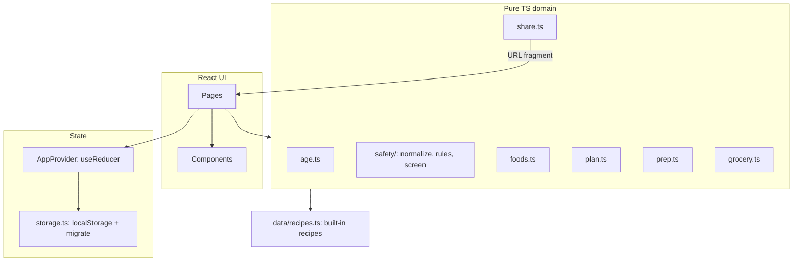

# Design Document

## Overview

FirstMenu is a static single-page app. All logic runs in the browser and all data lives in `localStorage`. The core is a small set of pure TypeScript modules (age, safety screen, foods, plan, prep, grocery, share) with no React dependency. The UI is a thin React layer on top of them. Keeping the domain pure means the safety rules can be tested exhaustively without rendering anything, which matters because the safety screen is the part that must be right.

Key decisions:

| Decision | Choice | Why |
| --- | --- | --- |
| Data location | `localStorage`, no backend (Option A) | Free hosting, no accounts, no baby data on a server. |
| Sharing | Read-only link with data in the URL fragment | Fragments are not sent to the host, so shared data stays between devices. |
| Routing | `HashRouter` | GitHub Pages has no server-side rewrites. Hash routes always load `index.html`. |
| State | React context + `useReducer` | The app has one store and a handful of actions. No state library needed. |
| Validation | `zod` | Imported files and share links are untrusted input. |
| Link compression | `lz-string` (`compressToEncodedURIComponent`) | Shrinks JSON to URL-safe text with no server. |
| Styling | Plain CSS with custom properties, CSS modules per component | Small, no runtime cost, easy theming. |
| Tests | Vitest + React Testing Library | Native to Vite. |

## Architecture



Derived data (screen results, foods, prep list, grocery list) is never stored. It is computed from state with memoized selectors, so a change to the birth date or a recipe updates every view at once (Requirement 1.6, 5.4, 9.5).

### Source layout

```
src/
  domain/
    types.ts          data models
    age.ts            ageInMonths, stageFor, defaultSlots
    safety/
      normalize.ts    tokenize, singularize, phrase matching
      rules.ts        the fixed rule list and sources
      screen.ts       screenIngredient, screenRecipe
    foods.ts          foodKeyFor, collectFoods, door/monster/ghost status
    plan.ts           week dates, slot helpers, new-food spacing warnings
    prep.ts           servings, batches, cook schedule
    grocery.ts        merge, group, check-state reconciliation
    share.ts          encode/decode share payload
    storage.ts        schema, migrate, load/save, export/import
  data/
    recipes.ts        built-in recipes
  state/
    AppProvider.tsx   context, reducer, persistence effect
    selectors.ts      memoized derived data
  ui/
    pages/            Home (haunted house), Recipes, RecipeDetail, RecipeEditor,
                      Foods, Prep, Grocery, Share, SharedView, Print, Settings,
                      Onboarding, Sources
    components/       GhostCard, MysteryDoor, FriendlyMonster, PumpkinBadge,
                      PrepReminder, Disclaimer, StorageBanner, SlotPicker
    assets/           SVG illustrations
    theme.css         color tokens, motion settings
```

## Data Models

```ts
type StageId = '6-8' | '9-12';
type MealType = 'breakfast' | 'lunch' | 'dinner' | 'snack';
type GroceryCategory = 'produce' | 'dairy-eggs' | 'protein' | 'grains' | 'pantry' | 'frozen' | 'other';

interface Ingredient {
  name: string;            // free text, the only input to the safety screen
  food?: string;           // "counts as" food key override; derived if absent
  quantity?: number;
  unit?: string;           // 'g', 'ml', 'tbsp', 'tsp', 'cup', 'piece', ...
  category: GroceryCategory;
}

interface Recipe {
  id: string;              // 'b-...' for built-in, uuid for custom
  source: 'builtin' | 'custom';
  title: string;
  stages: StageId[];
  mealTypes: MealType[];
  ingredients: Ingredient[];
  steps: string[];
  texture: string;         // e.g. "smooth puree", "soft finger strips"
  servings: number;        // servings one batch makes
  storage?: { fridgeDays?: number; freezerMonths?: number };
  makeAheadNote?: string;
}

interface ChildProfile { name?: string; birthDate: string /* YYYY-MM-DD */ }

interface FoodRecord {
  status: 'tried' | 'reaction';
  date: string;            // YYYY-MM-DD
  note?: string;
}

interface WeekPlan {
  startDate: string;       // YYYY-MM-DD
  prepDate: string;        // default startDate - 1 day
  activeSlots: MealType[];
  days: Array<Partial<Record<MealType, string /* recipe id */>>>; // length 7
}

interface AppState {
  schemaVersion: 1;
  child?: ChildProfile;
  onboarded: boolean;
  customRecipes: Recipe[];
  foods: Record<string /* food key */, FoodRecord>;
  plan: WeekPlan;
  groceryChecked: string[]; // grocery line keys
  disclaimerAcknowledged: boolean;
}
```

## Components and Interfaces

### Age (`age.ts`)

- `ageInMonths(birthDate, onDate)`: whole calendar months between the dates. A baby born 2026-01-15 is 9 months old on 2026-10-15 and 8 months old on 2026-10-14.
- `stageFor(months)`: `< 9 → '6-8'`, otherwise `'9-12'` (Requirement 1.3).
- `defaultSlots(stage)`: `6-8 → [breakfast, dinner]`, `9-12 → [breakfast, lunch, dinner, snack]`. These are starting defaults only; the user can change them (Requirement 8.2). **Open question for review: are these the defaults you want?**

The age used everywhere is `ageInMonths(child.birthDate, plan.startDate)` (Requirement 1.2). A share link carries this number directly.

### Safety screen (`safety/`)

#### Matching (`normalize.ts`)

1. Lowercase, strip accents (NFKD), replace every non-letter/digit with a space, collapse spaces. "Cow's Milk" → `cow s milk`.
2. Split into tokens. Rule terms are written in singular form. An ingredient token matches a term token `t` when it equals `t`, `t + "s"`, `t + "es"`, or (when `t` ends in `y`) `t` with the `y` replaced by `ies`. So `grapes`, `tomatoes`, `peaches`, `cheeses` and `berries` match `grape`, `tomato`, `peach`, `cheese` and `berry`. A test checks that every term in `rules.ts` is lowercase and singular.
3. A term matches when its tokens appear as a consecutive run in the ingredient's tokens.
4. A rule fires when any term matches and no exception term matches (Requirement 4.4).

Whole-token matching avoids the common false positives. These cases are required unit tests:

| Ingredient name | Must fire | Must not fire |
| --- | --- | --- |
| `Honey` | honey (block) | |
| `honeydew melon` | | honey |
| `sugar snap peas` | | added sugar |
| `brown sugar` | added sugar | |
| `peanut butter` | peanut (allergen), nut butter (reminder) | dairy, whole nuts |
| `unsalted butter` | dairy (allergen) | salt |
| `eggplant` | | egg |
| `2 eggs` | egg (allergen), egg (reminder) | |
| `red grapes` | grapes (reminder) | |
| `grapefruit` | | grapes |
| `cherry tomatoes` | cherry tomato (reminder) | cherry pits reminder |
| `lemon juice` | | juice |
| `apple juice` | juice (block) | |
| `xanthan gum` | | chewing gum |
| `breast milk` | | cow's milk, dairy |
| `whole milk yogurt` | dairy (allergen), milk (reminder) | |
| `almond flour` | tree nuts (allergen) | whole nuts reminder, wheat |
| `Swordfish` | high-mercury fish (block) | |
| `grated cheeses` | dairy (allergen), cheese (reminder) | |
| `hot dogs` | sausages (reminder) | |
| `egg noodles` | egg (allergen), wheat (allergen) | |
| `rice noodles` | | wheat |

#### Rule shape (`rules.ts`)

```ts
interface SafetyRule {
  id: string;
  kind: 'block' | 'reminder' | 'allergen';
  terms: string[];
  except?: string[];
  underMonths?: number;    // rule applies while age < underMonths
  allergenGroup?: AllergenGroup; // kind === 'allergen' only
  label: string;           // short name shown in UI, e.g. "Honey"
  message: string;         // plain-language reason or reminder
  sources: SourceId[];
}
```

`RULESET_VERSION` is a constant bumped whenever rules change.

#### Screen API (`screen.ts`)

```ts
interface Finding { ruleId: string; kind: RuleKind; ingredientIndex: number; ingredientName: string;
                    label: string; message: string; availableAtMonths?: number }
interface ScreenResult { blocks: Finding[]; reminders: Finding[]; allergens: Finding[] }

screenIngredient(name: string, ageMonths: number): Finding[]
screenRecipe(recipe: Recipe, ageMonths: number): ScreenResult
```

A recipe is ghosted when `blocks.length > 0` or when any of its foods has a `reaction` record (Requirement 5.1, 7.6). Reminders are de-duplicated by message per ingredient.

#### Initial rule list

All rules are matched against ingredient names only. Messages are drafts for review. Rules marked **(confirm source)** need their source checked in task 3.2 before release; until a source is confirmed, the rule stays in the list, because blocking or reminding too much is the safer failure.

**Block rules (ghosts)**

| id | Terms | Except | Under | Message | Sources |
| --- | --- | --- | --- | --- | --- |
| `honey` | honey | | 12 mo | Honey can cause infant botulism, even baked into food. | AAP-honey |
| `juice` | juice | lemon, lime | 12 mo | No fruit juice before 12 months. | AAP-juice |
| `added-sugar` | sugar, brown sugar, maple syrup, corn syrup, agave, molasses, syrup | snap | 24 mo | No added sugar before 2 years. | AAP-sugar, WHO-2023 |
| `sweeteners` | stevia, sucralose, aspartame, saccharin, sweetener | | 24 mo | No sugar substitutes for babies. | WHO-2023 |
| `added-salt` | salt, salted, soy sauce, fish sauce, bouillon, stock cube | | 24 mo | Don't add salt or salty sauces to baby food. | WHO-2023 |
| `high-mercury-fish` | shark, swordfish, king mackerel, bigeye tuna, marlin, orange roughy, tilefish | | none | High in mercury. Choose lower-mercury fish. | FDA-EPA-fish |
| `unpasteurized` | raw milk, unpasteurized | | none | Only pasteurized milk and cheese. (confirm source) | CDC-food-safety |
| `choking-no-safe-form` | popcorn, hard candy, chewing gum, gum, marshmallow | xanthan, guar | 48 mo | Choking hazard with no safe form for babies. | AAP-choking, CDC-choking, HHS-CFOC |

**Prep reminders (never block)**

| id | Terms | Except | Under | Reminder | Sources |
| --- | --- | --- | --- | --- | --- |
| `grapes` | grape, grape tomato | | 48 mo | Quarter lengthwise before serving. | AAP-choking, CDC-choking |
| `cherry-tomato` | cherry tomato | | 48 mo | Quarter lengthwise before serving. | CDC-choking |
| `cherries` | cherry | tomato | 48 mo | Remove pits and cut into small pieces. | CDC-choking |
| `small-round-fruit` | blueberry, raspberry, olive | | 48 mo | Flatten or cut into small pieces. | CDC-choking |
| `sausages` | hot dog, sausage | | 48 mo | Cut lengthwise into strips, then into small pieces. | AAP-choking |
| `whole-nuts` | peanut, almond, cashew, walnut, pecan, hazelnut, pistachio, macadamia, brazil nut, pine nut | butter, flour, meal, powder, ground, milk | 48 mo | Only finely ground or mixed into food. Never whole or in pieces. | AAP-choking |
| `nut-seed-butter` | peanut butter, almond butter, cashew butter, sunflower seed butter, tahini | | 48 mo | Thin with water, breast milk or formula, or spread thinly. Never a spoonful. | AAP-allergens, CDC-choking |
| `hard-produce` | carrot, apple, celery | sauce, juice | 48 mo | Cook until soft or grate finely. | CDC-choking |
| `dried-fruit` | raisin, prune, dried fruit, dried apricot, dried mango, dried fig | | 48 mo | Chop finely or soak until soft. | CDC-choking |
| `cheese` | cheese | | 48 mo | Grate or slice thinly. Use pasteurized cheese. | CDC-choking |
| `eggs-cooked` | egg | | none | Cook until white and yolk are firm. (confirm source) | CDC-food-safety |
| `cook-through` | chicken, beef, pork, turkey, lamb, fish, salmon, cod, trout, tilapia, shrimp | | none | Cook through and remove all bones. (confirm source) | CDC-food-safety |
| `cows-milk` | milk | breast, formula | 12 mo | Fine in cooking. Before 12 months, breast milk or formula should be the main drink. | AAP-milk |

**Allergen rules (mystery doors, never block)**

| Group | Terms | Except |
| --- | --- | --- |
| peanut | peanut | |
| egg | egg | |
| dairy | milk, buttermilk, yogurt, yoghurt, cheese, butter, cream, ricotta, kefir, ghee | breast, formula, peanut, almond, cashew, nut, seed, sunflower, apple, coconut, oat, soy, rice |
| tree nuts | almond, cashew, walnut, pecan, hazelnut, pistachio, macadamia, brazil nut, pine nut | |
| soy | soy, soya, tofu, edamame, tempeh, miso | |
| wheat | wheat, flour, bread, pasta, couscous, semolina, noodle, breadcrumb, cracker | almond, oat, rice, coconut, chickpea, corn, buckwheat |
| fish | fish, salmon, cod, tuna, tilapia, haddock, pollock, sardine, trout, halibut, catfish, whitefish, mackerel, anchovy, herring, flounder | |
| shellfish | shrimp, prawn, crab, lobster, crawfish, crayfish | |
| sesame | sesame, tahini | |

Sources for all allergen rules: AAP-allergens, NIAID-peanut.

Matching is whole-word, so a name the list doesn't contain (for example a fish species not listed) is not recognized. Requirement 13.2 tells users about this limit. Adding a term is a one-line change plus a test case.

#### Sources

| id | Source |
| --- | --- |
| AAP-honey | [AAP HealthyChildren: Caring for your child's cold](https://www.healthychildren.org/English/health-issues/conditions/flu/Pages/caring-for-Your-childs-cold-or-flu.aspx) |
| AAP-juice | [AAP HealthyChildren: How to reduce added sugar](https://www.healthychildren.org/English/healthy-living/nutrition/Pages/How-to-Reduce-Added-Sugar-in-Your-Childs-Diet.aspx) |
| AAP-sugar | [AAP News: Added sugar in kids' diets](https://publications.aap.org/aapnews/news/pdfDownload/7331) |
| AAP-milk | [AAP HealthyChildren: Feeding your baby when money is tight](https://www.healthychildren.org/English/tips-tools/ask-the-pediatrician/Pages/how-should-we-feed-our-baby-if-running-low-on-money.aspx), [Cow's milk alternatives FAQ](https://www.healthychildren.org/English/healthy-living/nutrition/Pages/milk-allergy-foods-and-ingredients-to-avoid.aspx) |
| AAP-choking | [AAP HealthyChildren: Choking prevention](https://www.healthychildren.org/English/health-issues/injuries-emergencies/Pages/Choking-Prevention.aspx) |
| AAP-allergens | [AAP HealthyChildren: When to introduce egg, peanut butter and other allergens](https://www.healthychildren.org/English/healthy-living/nutrition/Pages/when-to-introduce-egg-peanut-butter-and-other-common-food-allergens-to-your-baby-food-allergy-prevention-tips.aspx) |
| NIAID-peanut | [NIAID: Addendum guidelines for the prevention of peanut allergy](https://www.niaid.nih.gov/sites/default/files/peanut-allergy-prevention-guidelines-clinician-summary.pdf) |
| WHO-2023 | [WHO Guideline for complementary feeding of infants and young children 6–23 months (2023)](https://www.who.int/publications/i/item/9789240081864) |
| FDA-EPA-fish | [EPA-FDA advice about eating fish and shellfish](https://www.epa.gov/choose-fish-and-shellfish-wisely/epa-fda-advice-about-eating-fish-and-shellfish) |
| CDC-choking | [CDC: Choking hazards](https://www.cdc.gov/infant-toddler-nutrition/foods-and-drinks/choking-hazards.html) |
| CDC-solids | [CDC: When, what and how to introduce solid foods](https://www.cdc.gov/infant-toddler-nutrition/foods-and-drinks/when-what-and-how-to-introduce-solid-foods.html) |
| HHS-CFOC | [Caring for Our Children 4.5.0.10: Foods that are choking hazards](https://childcareta.acf.hhs.gov/cfoc/basic/chapter/4/4.5.0.10) |
| CDC-food-safety | To be confirmed in task 3.2 |

### Foods and first tastes (`foods.ts`)

- `foodKeyFor(ingredient)`: if any allergen rule fires, the key is `allergen:<group>` (an ingredient can map to more than one group: "egg noodles" maps to egg and wheat). Otherwise use `ingredient.food` if set; otherwise derive it from the name by normalizing, dropping descriptor words (fresh, frozen, ripe, cooked, raw, chopped, diced, mashed, pureed, grated, ground, organic, plain, whole, unsalted, low sodium, canned, small, medium, large, baby) and quantities.
- Ignored foods, never shown as doors: water, breast milk, formula, ice.
- `foodStatus(key, state, ageMonths)`: `ghost` if a block rule covers it for this age or a `reaction` is recorded; `monster` if `tried`; otherwise `door`.
- Allergen door guidance text (Requirement 7.7) lives next to the rules and cites AAP-allergens and NIAID-peanut.

#### New-food spacing warning (`plan.ts`)

For each untried food in the plan, find the first day it appears. Sort those first days. If any two distinct untried foods have first days less than `NEW_FOOD_SPACING_DAYS = 3` apart, show one warning listing them (Requirement 7.8). The 3-day value comes from common pediatric advice to wait a few days between new foods. **(confirm source in task 3.2)**

### Plan (`plan.ts`)

- `defaultStartDate(today)`: today if Monday, else the next Monday.
- A slot shows one of: empty, recipe, ghosted recipe (Requirement 5.4).
- New week (Requirement 8.5): `keep` shifts `startDate` and `prepDate` by 7 days and keeps `days`; `empty` clears `days`. Grocery checks are cleared in both cases.

### Prep list (`prep.ts`)

For each recipe in non-ghosted slots:

1. `servingsNeeded` = number of slots using it.
2. `useDays` = sorted day offsets from `prepDate` (prep day = 0, first plan day usually = 1).
3. Schedule:
   - If `fridgeDays` is set and every use day ≤ `fridgeDays`: cook all batches on prep day, keep in fridge.
   - Else if `freezerMonths` is set: cook all batches on prep day. Uses within `fridgeDays` stay in the fridge; the rest are frozen in single portions with "thaw in the fridge the night before" on the day before each use.
   - Else: cook fresh. Group uses greedily: start a cook session on the first remaining use day, cover every use within `fridgeDays` of it (or only that day if `fridgeDays` is unset), repeat.
4. `batches` = sum over cook sessions of `ceil(servingsInSession / recipe.servings)`.

Output: a list of cook sessions by date (`{ date, recipeId, batches, store: 'fridge' | 'freezer' | 'serve' }`) plus thaw reminders. Built-in storage values are authored per recipe and checked against food-safety guidance in task 4.1.

### Grocery list (`grocery.ts`)

1. For each cook session, add each ingredient × `batches`.
2. Line key = `foodKey + '|' + normalizedUnit`. Merge quantities with the same key. Lines with no quantity become "as needed"; if any merged line has no quantity, the total shows the known sum plus "and more as needed".
3. Group by `category` in a fixed order: produce, protein, dairy-eggs, grains, pantry, frozen, other.
4. Attach every prep reminder from the merged ingredients.
5. Reconcile checks: keep `groceryChecked` entries whose line key still exists (Requirement 10.5).

No unit conversion in v1. "1 cup" and "200 g" of the same food stay as two lines (Requirement 10.2).

### Share link (`share.ts`)

Payload (validated with zod on decode):

```ts
interface SharePayload {
  v: 1;
  rulesetVersion: number;
  ageMonths: number;
  plan: WeekPlan;
  recipes: Recipe[];                  // only recipes used in the plan
  foods: Record<string, FoodRecord>;  // notes stripped
}
```

- Encode: `JSON.stringify` → `lz-string.compressToEncodedURIComponent` → `https://ashikratnani.github.io/FirstMenu/#/shared/<data>`.
- No name, birth date or food notes (Requirement 11.3).
- `SHARE_WARN_LENGTH = 4000` characters. Above this, show the warning from Requirement 11.6. The link is still created.
- Decode failure, zod failure or unknown `v` → "This link can't be read" with no partial render (Requirement 11.5).
- The shared view renders from the payload only and never dispatches to the store (Requirement 11.4). The viewer runs its own copy of the rules, so a link made before a rule change gets the newer rules.

### Print view

A route with print CSS: no illustrations or color fills, ghost/door/monster states as text labels, one page for the week grid and prep list, then the grocery list. Opened from the plan with a "Print" button that calls `window.print()`.

### Storage (`storage.ts`)

- Key: `firstmenu`. Value: `AppState` JSON.
- On load: parse → `migrate(fromVersion)` → zod validate. On failure, copy the raw value to `firstmenu:backup-<timestamp>`, start fresh and show a notice.
- Save is debounced by 300 ms after each state change.
- If `setItem` throws (Safari private mode, quota), show the storage banner (Requirement 12.7).
- Export: download `firstmenu-backup-YYYY-MM-DD.json`. Import: zod-validate and migrate, then replace state only on success (Requirement 12.5).

## Theme mapping

| Theme element | Feature | Text equivalent |
| --- | --- | --- |
| Friendly ghost (translucent card, "Not yet" label) | Recipe or food blocked by the safety screen or a reaction | "Not yet: honey. Available at 12 months." |
| Mystery door | Untried food | "New food: egg" |
| Friendly monster (door opens) | Food marked tried with no reaction | "Tried on Nov 12" |
| Pumpkin badge | Freezer-friendly recipe | "Freezes for 3 months" |
| Haunted house with 7 windows | Week plan home screen, one window per day | Day names and meals listed as text |
| Lantern | Prep reminder | "Prep: quarter lengthwise" |

Ghost, door, monster and pumpkin are the parts you specified. The haunted house home screen and lantern reminders are my proposals; **please confirm or replace them.**

Visual rules: soft purples, oranges and creams; rounded shapes; ghosts smile; no skulls, blood, sharp teeth or jump scares (Requirement 14.1). Animations (door opening, ghost floating) are CSS only and disabled under `prefers-reduced-motion: reduce` (Requirement 14.5). All illustrations are inline SVG with `aria-hidden="true"`; the state is carried by visible text and the accessible name (Requirement 14.3).

## Error Handling

| Situation | Behavior |
| --- | --- |
| Storage unavailable or full | Banner: "Changes can't be saved on this device." App keeps working in memory. |
| Corrupt stored data | Raw value backed up under a new key, fresh state, notice with an export-backup option. |
| Invalid import file | Rejected with the validation reason. Existing data unchanged. |
| Invalid share link | "This link can't be read. Ask for a new one." Nothing else rendered. |
| Plan references a deleted recipe | Slot emptied on load, notice listing emptied slots (Requirement 3.5). |
| Child under 6 months or 12 months and over | Notices from Requirement 1.4 and 1.5. |

## Testing Strategy

The safety screen is the part where a bug can hurt someone, so it gets the most tests. Everything else gets enough to catch regressions.

- **Unit (Vitest), domain modules:**
  - `normalize`: tokenizing, singularizing, phrase matching.
  - `screen`: every case in the matching table above, plus each rule firing on at least one term and respecting its age limit at `limit - 1` and `limit` months.
  - Built-in recipe checks (Requirements 2.1, 2.5, 2.6): count per stage, all nine allergen groups covered, no block findings at the youngest age of each tagged stage, every recipe has a valid category for each ingredient.
  - Rules: every rule has at least one source and every source id exists.
  - `age`: month boundaries, leap years, end-of-month birthdays.
  - `prep`: fridge, freezer and cook-fresh schedules, batch rounding.
  - `grocery`: merging, separate units, "as needed", check reconciliation.
  - `share`: round-trip, size, rejection of tampered or truncated data, absence of name and birth date.
  - `storage`: migration, corrupt data recovery, import rejection.
- **Component (React Testing Library):** ghosted recipe cannot be added to a slot; marking a door as tried shows the monster; marking a reaction ghosts recipes; share view does not write to storage.
- **Accessibility:** `vitest-axe` on main pages, plus a manual keyboard and VoiceOver pass on iOS Safari.
- **CI:** lint, test and build on every pull request.

## Open questions for review

1. Default meal slots per stage (see Age above).
2. Haunted house home screen and lantern reminders (see Theme mapping).
3. Rules marked "confirm source" stay in the list until confirmed. If you'd prefer to drop any instead, say which.
4. The built-in recipes will be written by Kiro from general baby-feeding practice. You and your wife should review them before the demo (task 4.3).
